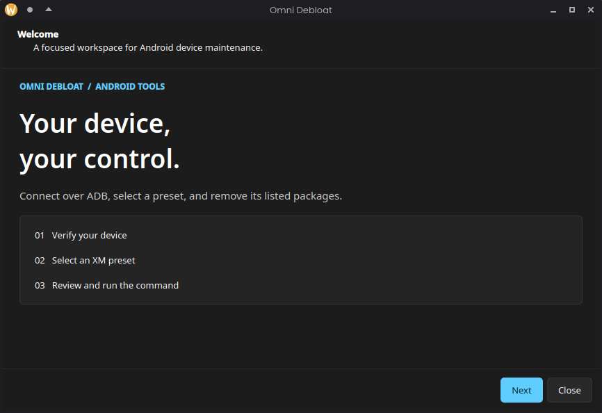

# 📱 Omni Debloat

[](https://opensource.org/licenses/MIT)
[](http://makeapullrequest.com)
[](https://github.com/)
[](https://discord.gg/AxAvFCyVvK)

**Omni Debloat** is a powerful, streamlined tool designed to help you strip away unwanted bloatware from your smartphone, reclaiming your privacy, storage, and battery life. 



---

## 🚀 Features

*   **Presets Support:** Choose from curated official presets or experiment with community-driven configurations.
*   **Interactive User Interface:** A beginner-friendly, guided wizard that safely walks you through the debloating process.
*   **Developer Tools (WIP):** A Tool That Helps To Develop Presets With Minimal Effort, Work in progress its not ready for use 

---

## 🛠️ Presets

The tool relies on configuration presets to know what to remove:

| Preset Type | Reliability | Description
| :--- | :--- | :--- | 
| **Official Presets** | 🟢 Safe | Tested configurations designed *not* to brick your phone. Available in the repository. |
| **User Presets** | 🟡 Experimental | Community-made presets. Use with caution as they are largely untested and may break features. |

---

> [!NOTE]
> Even IF a Device Doesnt have Presets, Omni Debloat Will Use a Custom Generic One to Similar devices, Or Common Bloatware. It Will ask you which apps that some people don't Find bloat and will Remove them accordingly!


## ⚠️ Disclaimer

> [!WARNING]
> **Use this software at your own risk.** 
> While official presets are designed to be safe and won't brick your device, we are **not responsible** for any damages, bootloops, or data loss this software may cause. Always backup your data before proceeding.
> 
> *Note: **Developer Tools** is currently a Work In Progress (WIP). We do not recommend using it in its current state unless you know exactly what you are doing.*

---


---

## ⚖️ Why Omni Debloat? (vs. UAD-NG)

While excellent tools like *Universal Android Debloater Next Generation (UAD-NG)* exist, **Omni Debloat** is built with a different philosophy:

* **Reduced Risk via Presets:** Instead of guessing which individual packages to uninstall, our curated **Official Presets** eliminate the guesswork, drastically reducing the risk of bootloops or stripping critical system functions.
* **Friendly GUI Experience:** No overwhelming messy UI, Omni Debloat Has Been Designed with Ease of Use in mind so it will be pretty easy to debloat your device!

---

## 🗺️ Future Plans

We are constantly working to make Omni Debloat better. Here is what is planned for future releases:

| 📋 To Do | ⏳ In Progress | ✅ Done |
| :--- | :--- | :--- |
| 🔹 Auto-Create Presets | 🔸 Fixing Bugs | 🔹 Core ADB integration |
| 🔹 Development Platform | 🔸 Cleaning Code | 🔹 Official Presets engine |
| 🔹 More Manufacturer Support | 🔸 Expanding The Developer Tools | 🔹 Added A New User Interface! |
| 🔹 Extentions | 🔸 ~~GUI~~ | 🔹 Discord Server Launch |


## 📦 Getting Started

### Prerequisites
*   Android Device with **USB Debugging** enabled.
*   A USB cable to connect your phone to your PC.

### Building From Scratch

1. Clone the repository:
   ```
   git clone https://github.com/Thvrett77/Omni_Debloat
   ```
   
2. Installing Pyinstaller To Bundle the files into one .exe or a linux binary
   ```
   pip install pyinstaller
   ```

4. Pyinstaller Command For Windows
   ```
   pyinstaller (GUI.py from the src/ directory) --optimize 2 --upx-dir "Include Your Windows UPX compressor directory" --clean --onefile --windowed --exclude-module tkinter --exclude-module xml
   ```
5. Pyinstaller Command For Linux (basically the same thing but to clear confusion its below
   ```
   pyinstaller (GUI.py from the src/ directory) --optimize 2 --upx-dir "Include Your Linux UPX compressor directory" --clean --onefile --windowed --exclude-module tkinter --exclude-module xml
   ```
 


